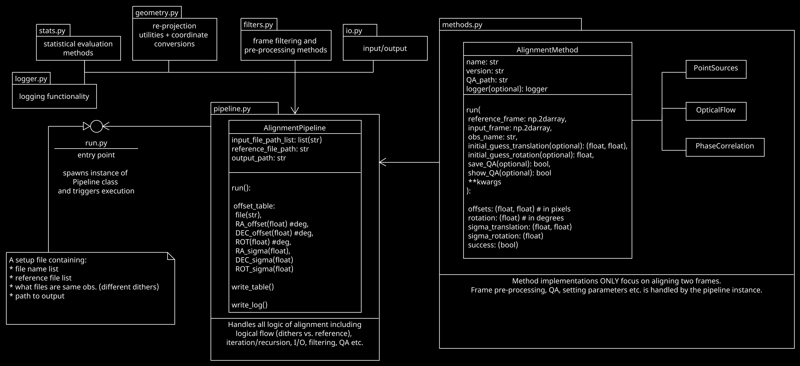

# muse_astrometric_registration

### DEVELOPMENT GROUNDS ###

# KEEP PRIVATE #

# Installation

***Tested on Python 3.12.***

### Spacepylot submodule 

The repository relies on the ```spacepylot``` submodule, which is a [fork of the original ```spacepylot``` repository](https://github.com/KostasValeckas/spacepylot/tree/5dfca0975f47b163739fc1d551baf6f2da0d2b15).

If you have cloned the code using git, you need to initialize the submodule with:

```
git submodule update --init --recursive

```

The submodule link is setup to use https, so if you want to use ssh instead, you can change the link in the ```.gitmodules``` file.

-------------------------

### Installing dependencies


Extra dependencies are in the ```requirements.txt``` file. Install them with:

```
pip install -r requirements.txt
```

# Running the pipeline

------------------------------------------------------------------------------

### Input

The pipeline input is a ```.json``` file with the following formatting:

```
{
    Pointing number (str): [
        [
            Dither number (int),
            Observation time (str),
            Filename (str)
        ],
        ...
    ],
    ...
    "headers": {
        "date_keyword": fits keyword for date of observation (str),
        "mjd_keyword": fits keyword for MJD of observation (str),
        "tpl_start_keyword": fits keyword for template start (str),
        "exp_keyword": fits keyword for exposure number (str),
        "pointing_keyword": fits keyword for pointing number (str)
    }
}
```

There are several examples in the ```dev``` directory. In practice, the 
input file will look something like this (snippet):

```
{
    "1": [
        [
            1,
            "2021-11-27T03:13:14.863",
            "IMAGE_FOV_prealign_OB001_WFI_BB_2021-11-27T03:07:22_0001.fits"
        ],
        [
            2,
            "2021-11-27T03:18:29.277",
            "IMAGE_FOV_prealign_OB001_WFI_BB_2021-11-27T03:07:22_0002.fits"
        ],
        [
            3,
            "2021-11-27T03:23:43.565",
            "IMAGE_FOV_prealign_OB001_WFI_BB_2021-11-27T03:07:22_0003.fits"
        ],
        [
            4,
            "2021-11-27T03:28:58.097",
            "IMAGE_FOV_prealign_OB001_WFI_BB_2021-11-27T03:07:22_0004.fits"
        ]
    ],
    "2": [
        [
            1,
            "2021-11-30T02:12:44.409",
            "IMAGE_FOV_prealign_OB002_WFI_BB_2021-11-30T02:05:15_0001.fits"
        ],
        ...
    ],
    
    ...
    
    "headers": {
        "date_keyword": "DATE-OBS",
        "mjd_keyword": "MJD-OBS",
        "tpl_start_keyword": "HIERARCH ESO TPL START",
        "exp_keyword": "HIERARCH MUSEPIPE_IEXPO",
        "pointing_keyword": "MUSEPIPE_DATASET"
    }
}
```
------------------------------------------------------------------------------

### Preparing the configuration file

There is a script in the ```dev``` directory called ```sorter.py```. It can 
produce a configuration file from a directory with MUSE data. Three FITS keywords 
control the sorting of the data: the pointing number, the exposure number and the observation time.

In the script, the defaults for these are set to the following:

```
pointing_keyword = "HIERARCH MUSEPIPE_POINTING"
exp_keyword = "HIERARCH MUSEPIPE_IEXPO"
date_keyword = "DATE-OBS"
```

The script can be called with the default headers by simply giving the input directory as the argument:

```
python sorter.py /path/to/directory/with/muse/data
```

From experience, for some datasets, the headers might differ. The following flags allow for that:

```
  --pointing_keyword POINTING_KEYWORD
                        Keyword for the pointing. Default is 'HIERARCH MUSEPIPE_POINTING'.
  --exp_keyword EXP_KEYWORD
                        Keyword for the exposure time. Default is 'HIERARCH MUSEPIPE_IEXPO'.
  --date_keyword DATE_KEYWORD
                        Keyword for the observation date. Default is 'DATE-OBS'.

```

Furthermore, these flags can specify output filename, and two more headers that are used 
for the output table of the pipeline (not needed for initial sorting):

  --output_dir OUTPUT_DIR
                        Directory to save the results. Default is current working directory.
  --output_filename OUTPUT_FILENAME
                        Name of the output JSON file. Default is 'sorted_files.json'.
  --mjd_keyword MJD_KEYWORD
                        Keyword for the observation MJD. Default is 'MJD-OBS'.
  --tpl_start_keyword TPL_START_KEYWORD
                        Keyword for the template start. Default is 'HIERARCH ESO TPL START'.


------------------------------------------------------------------------------

### Execution

The current entry point is the script ```run.py``` in the ```src``` directory.

An example call to the script is:

```
python run.py NGC0253.json NGC0253_Rc_flux_wcomb.fits --input_dir /NGC0253/MUSE/ --output_dir NGC0253_TEST
```

Where the different parameters are:


```
python run.py configuration_file reference_file --input_dir path_to_directory_with_data --output_dir path_to_directory_where_QA_plots_and_results_will_be_stored
```
------------------------------------------------------------------------------


### Repository structure




