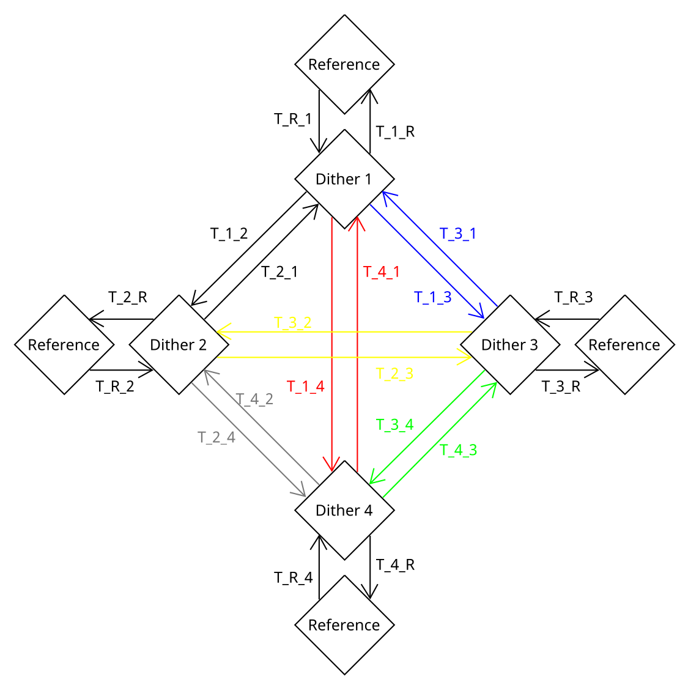
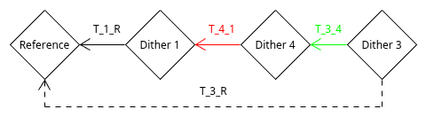
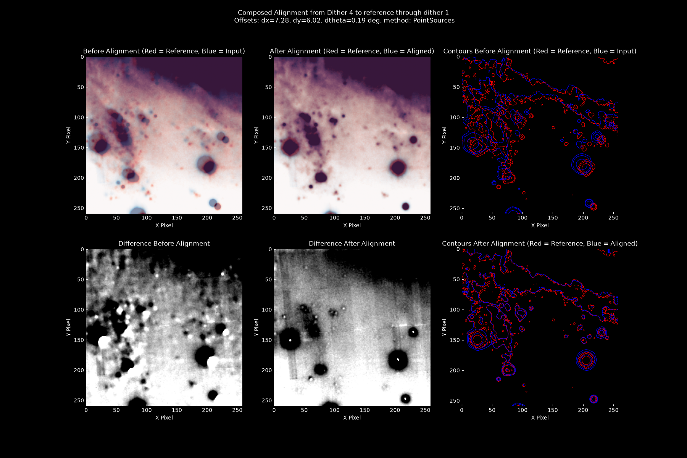
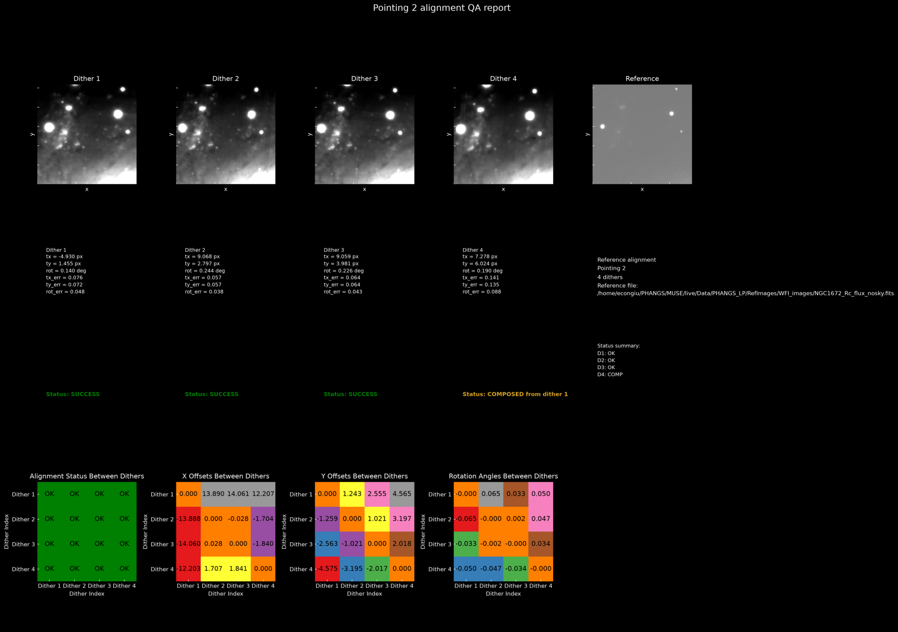

.. _dithers:

Dither alignment and status codes
=================================

Every dither in the :ref:`configuration file <conf>` is aligned to the reference in both directions (reference -> dither and
dither -> reference), and the two results are checked for consistency (round trip
within ``--distance_threshold`` parameter value). Dithers are also aligned to each other, which is
used to recover the science alignments that failed:

* ``--dither_mode full`` aligns all dither pairs before the science alignment (a
  dither aligned to itself is the identity and is not run).
* ``--dither_mode targeted`` aligns the science frames first, and then only the
  dither pairs needed to recover the ones that failed. Every link is aligned in both
  directions and checked for consistency, like the science alignment; a link is only
  used if both directions work and agree (a one-sided or disagreeing link is marked
  inconsistent). The candidate paths are tried one at a time, shortest first: e.g.
  to recover dither 3 from clean dither 1 it tries 3 - 1, then 3 - 2 - 1, then
  3 - 4 - 1, and so on, skipping every path through a link that already failed.
  Paths that reuse already verified links and links the guess methods measured go
  first. Every link is aligned at most once. If all science alignments are clean,
  no dither alignment is run at all.

    All alignments that can be estimated for a pointing with 4 dithers.
    :math:`T_{i \to R}` and :math:`T_{R \to i}` are the science alignments of
    dither :math:`i` to and from the reference, :math:`T_{i \to j}` the dither -
    dither alignments.

Recovering failed alignments
----------------------------

A failed science alignment is replaced by the shortest composition through direct
measurements (reference -> clean dither -> ... -> failed dither). The path length is
the number of direct measurements; a mirrored measurement (the inverse of the
opposite direction) counts as direct, and there is no limit on the length. Errors of
the links are added in quadrature.

For example, if the alignment of dither 3 to the reference fails, but dither 3 is
aligned to dither 4, dither 4 to dither 1, and dither 1 to the reference, then

.. math::

    T_{3 \to R} = T_{1 \to R} \circ T_{4 \to 1} \circ T_{3 \to 4},

where :math:`\circ` means "apply the right-hand transform first".

    Recovering the alignment of dither 3 to the reference (dashed) by composing
    dither - dither alignments with the alignment of dither 1 to the reference.

Dithers are usually easier to align with each other than with the reference, so
this fallback recovers a whole pointing as long as one dither aligns to the
reference and the dither - dither links connect it to the others. Composed
alignments have larger errors, since the errors of every link add up.

.. _composing_transformations:

Composing transformations
-------------------------

Every alignment is a Euclidean transform: a rotation by :math:`\theta` about the
image centre :math:`\mathbf{c}`, followed by a translation
:math:`\mathbf{t} = (t_x, t_y)^\top`. With the rotation matrix

.. math::

    R(\theta) = \begin{pmatrix} \cos\theta & -\sin\theta \\
                                \sin\theta & \cos\theta \end{pmatrix},

a pixel :math:`\mathbf{x} = (x, y)^\top` is mapped to

.. math::

    T(\mathbf{x}) = R(\mathbf{x} - \mathbf{c}) + \mathbf{c} + \mathbf{t}
                  = R\,\mathbf{x} + \mathbf{b},
    \qquad \mathbf{b} = (I - R)\,\mathbf{c} + \mathbf{t},

so every transform is a rotation plus one effective translation :math:`\mathbf{b}`.
It can be written as a single :math:`3 \times 3` matrix acting on
:math:`(x, y, 1)^\top`:

.. math::

    \mathbf{T} = \begin{pmatrix} R & \mathbf{b} \\ \mathbf{0}^\top & 1 \end{pmatrix}.

Applying :math:`T_1` and then :math:`T_2` is again a Euclidean transform, the
matrix product :math:`\mathbf{T}_{21} = \mathbf{T}_2 \mathbf{T}_1`:

.. math::

    T_2(T_1(\mathbf{x})) = R_2 R_1\,\mathbf{x} + (R_2\,\mathbf{b}_1 + \mathbf{b}_2),

    R_{21} = R_2 R_1, \qquad \mathbf{b}_{21} = R_2\,\mathbf{b}_1 + \mathbf{b}_2.

The angles add, :math:`\theta_{21} = \theta_1 + \theta_2`. The second translation
is unchanged, while the first one is rotated by :math:`R_2`, so the order matters:
in general :math:`\mathbf{T}_1 \mathbf{T}_2 \neq \mathbf{T}_2 \mathbf{T}_1`.

A mirrored measurement is the inverse transform,

.. math::

    \mathbf{T}^{-1} = \begin{pmatrix} R^\top & -R^\top \mathbf{b} \\
                                      \mathbf{0}^\top & 1 \end{pmatrix},

i.e. :math:`T_{j \to i} = T_{i \to j}^{-1}`. The composed matrix is converted back
to :math:`(t_x, t_y, \theta)` about the image centre with
:math:`\mathbf{t} = \mathbf{b} - (I - R)\,\mathbf{c}`. In the pipeline,
:math:`\theta` is the negative of the reported rotation angle, see
:ref:`rotation_convention`.

Example
-------

    QA plot of a composed alignment (NGC1672, pointing 2, PointSources): the
    alignment of dither 4 to the reference failed and was recovered through
    dither 1. The title gives the path and the composed offsets.

    Combined QA plot of the same pointing (full dither mode). Dithers 1 - 3
    aligned directly to the reference (SUCCESS), dither 4 was composed from
    dither 1 (COMPOSED). The bottom row shows the status, x and y offsets and
    rotation of every dither - dither alignment; in full mode all pairs are
    aligned.

Status codes
------------

The status codes in the tables and QA plots are:

.. list-table::
    :header-rows: 1

    * - Code
      - Meaning
    * - 1
      - direct measurement, consistent
    * - 0.5
      - composed (or mirrored)
    * - 0.7
      - inconsistent - never written to the output table (null values)
    * - 0
      - failed
    * - -1
      - not attempted (targeted dither mode, light gray in the QA plots)
