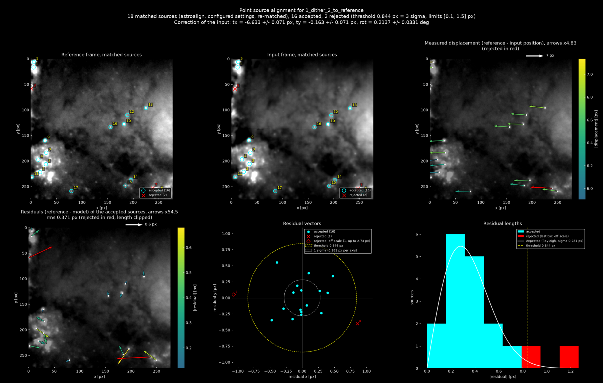
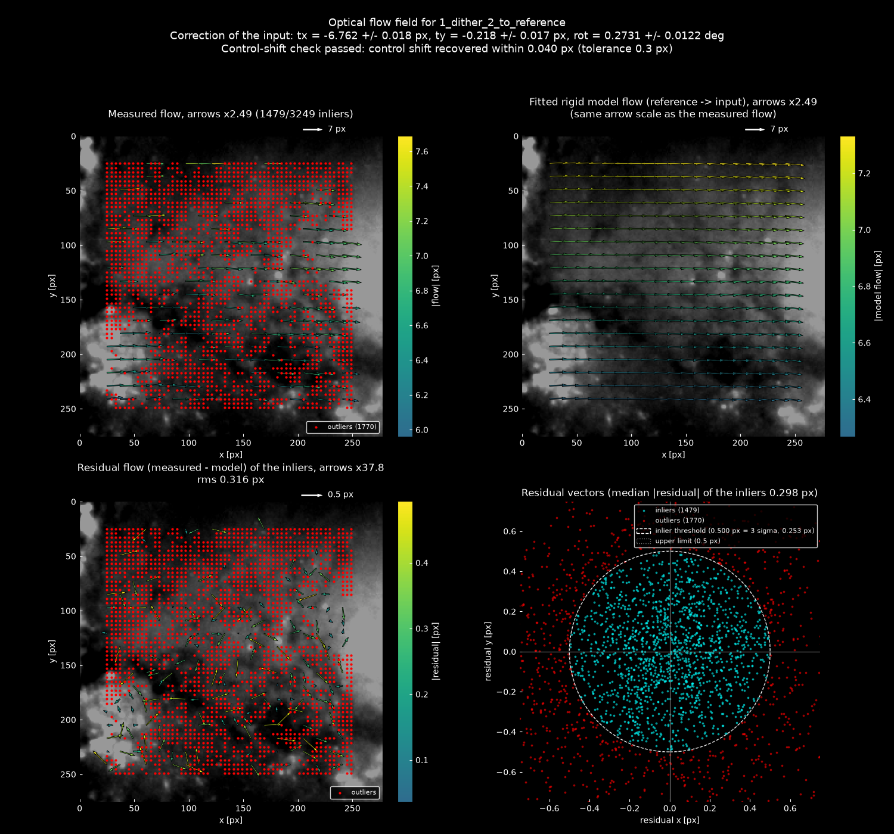
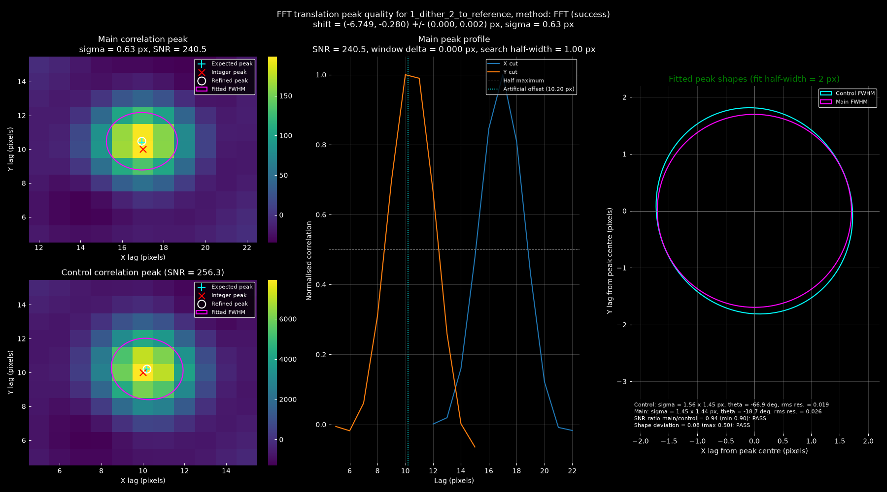
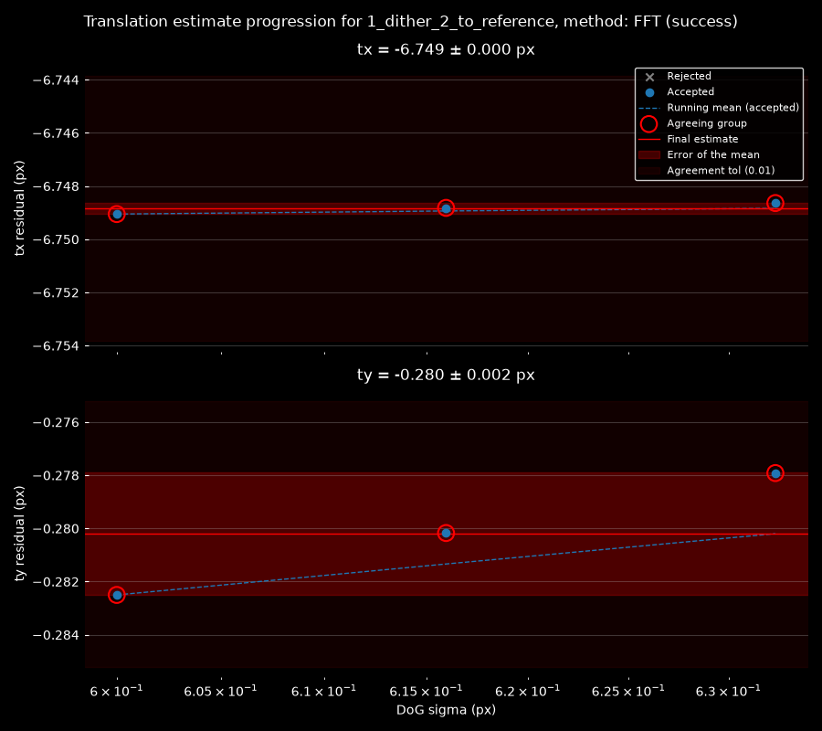
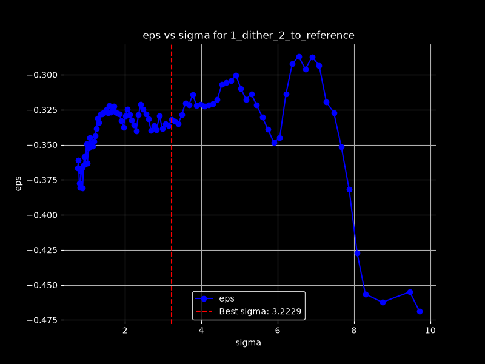

.. _methods:

Alignment methods
=================

The pipeline supports several different alignment methods to cover different edge
cases in MUSE data. The methods all follow the same API. If you wish to implement
another method to support your case, see :ref:`implementing a new method
<new_method>` at the end of this page.

The method is chosen with ``--method`` in the :ref:`single method run <run>`, or with
``--primary`` / ``--secondary`` / ``--tertiary`` in the :ref:`hybrid run <hybrid>`.

.. _method_noalignment:

NoAlignment
-----------

Does nothing, for testing the plumbing (with the :ref:`angle scan <angle_scan>`
it only scans the rotation).

.. _method_pointsources:

PointSources
------------

Matches point sources with ``astroalign`` and fits a rotation + translation to the
matched pairs (least-squares errors). astroalign only returns the sources of its
matched triangles (from at most its 50 brightest detections), so its transform is
used to re-match all sources detected in both frames (3 sigma, min. area 5 px,
unambiguous mutual nearest neighbours within 3 px); the astroalign matches are kept
if that finds fewer. Before the matching, bright sources (e.g. saturated stars) are
removed from both frames: pixels more than 50 robust standard deviations above the
median of each frame, with a radius of 15 px (``bright_source_sigma``). The
threshold is relative to each frame, so it does not depend on the unit of the
reference.

Every alignment gets a QA plot ``point_sources_*.png``: the numbered matched
sources in both frames (accepted / rejected), the measured displacements, the fit
residuals in the frame and in the (dx, dy) plane with the threshold, and a
histogram of the residual lengths against the expected Rayleigh distribution.

    ``point_sources_*.png`` for dither 2 to the reference of the :ref:`worked
    example <worked_example>`. 18 sources were matched, 16 accepted and 2 rejected
    (red) by the 0.84 px threshold. **Top:** the matched sources in the reference
    and the input, and the measured displacements (~7 px to the left). **Bottom:**
    the fit residuals in the frame (rms 0.37 px), as vectors with the threshold
    (dashed) and 1 sigma (dotted) circles, and the histogram of the residual
    lengths with the expected Rayleigh distribution.

Outliers are rejected with an adaptive threshold (see :ref:`outliers`), limits
[0.1, 1.5] px. Matched centroids on real MUSE data scatter by 0.2-0.8 px per axis
and mismatches are off by 1.5-5 px. The first fit uses a robust (soft-L1) loss, so
mismatches do not set the first threshold. An alignment needs at least 5 accepted
sources to count as successful; if astroalign finds fewer matches, its settings are
loosened step by step before giving up.

.. _method_opticalflow:

OpticalFlow
-----------

``spacepylot`` computes the dense TV-L1 flow field between the frames, and the rigid
transform is fitted to a grid of flow vectors in this repository (not with
``spacepylot``'s own homography step, which refers the translation to the corner of
its cropped frame and whose translation-only fit is broken with ``skimage`` >= 0.26).
Errors come from a spatial block bootstrap of the flow vectors (5x5 tiles). If the
inliers lie in too few tiles for the bootstrap, a conservative fallback is used
(residual scatter of the flow vectors over sqrt(number of tiles)), never 0.

Every alignment gets a flow field QA plot ``flow_field_*.png``: the measured flow,
the fitted rigid model, the residual flow and the residual vectors.

    ``flow_field_*.png`` for dither 2 to the reference of the :ref:`worked example
    <worked_example>`. **Top left:** the measured flow vectors, with the outliers
    in red (1479 of 3249 vectors are inliers). **Top right:** the fitted rigid model
    on the same arrow scale (~7 px shift). **Bottom:** the residual flow of the
    inliers (rms 0.32 px) and the residual vectors with the 0.5 px threshold. The
    title gives the result and the control-shift check (recovered within 0.04 px).

Because TV-L1 can fail silently (flow frozen at zero, which is perfectly smooth and
passes the forward/reverse consistency check):

* The filtered frames are scaled to unit standard deviation before TV-L1. Without
  this the flow of smooth fields stays at zero (a 3.6 px shift came out as 0.02 px).
* Control-shift check: the input aligned with the result is shifted by a known
  (1.7, -2.3) px, and the flow must recover that shift within 0.3 px. If not, the
  alignment is set as failed (only ``failed_aligment_*.png``); the log states the
  recovered error.

Outliers are rejected with an adaptive threshold (see :ref:`outliers`), limits
[0.05, 0.5] px (TV-L1 residuals scatter by ~0.07 px on synthetic frames, but by
~0.26 px on real data, see :ref:`known limitations <known_limitations>`).

.. _method_fft:

FFT
---

Phase correlation on band-passed (difference of Gaussians) frames, over a range of
filter scales (sigmas), with a known control offset as a self-check. A translation
is accepted when several consecutive sigmas agree, the control offset is recovered
(``control_tol``, 0.05 px), and the peak has at least 90% of the control peak SNR
and a similar shape (elliptical Gaussian fits, shown in the
``translation_peak_*.png`` QA plots). With an initial guess, the peak is only
searched within +/- 1 px of it.

The direct rotation estimate compares the band-passed frames in polar Fourier
coordinates, where a rotation becomes a shift in angle, for every sigma, against a
known control rotation. The rotation of the sigma with the highest peak SNR among
those that recover the control rotation is used. With the :ref:`angle scan
<angle_scan>` (the default for the primary method of the hybrid run), this
estimate is only the first check before the scan.

FFT makes three method-specific QA plots per alignment (and the
``angle_scan_model_*.png`` plot of the angle scan):

    ``translation_peak_*.png`` for dither 2 to the reference of the :ref:`worked
    example <worked_example>`. **Left:** the main and the control correlation
    peaks with the expected, integer and refined peak positions and the fitted
    FWHM. **Middle:** x and y cuts through the main peak. **Right:** the fitted
    peak shapes of the main and control peaks; the SNR ratio (0.94, min. 0.90) and
    the shape deviation (0.08, max. 0.50) both pass.

    ``translation_progression_*.png``: the translation estimate at every sigma
    (accepted / rejected), the group of consecutive sigmas that agree within the
    tolerance (circled), and the final estimate with the error of the mean.

    ``eps_vs_sigma_*.png``: the direct rotation estimate (eps, the rotation is
    -eps) at every sigma, and the sigma that was used (dashed). Here the estimate
    varies between -0.30 and -0.47 degrees with sigma, which is why the direct
    rotation fits are not precise to sub-degree level, see :ref:`known limitations
    <known_limitations>`.

.. _outliers:

Outlier rejection
-----------------

Both ``PointSources`` and ``OpticalFlow`` reject outliers iteratively with an
adaptive threshold on the length of the residual vector: 3 robust sigmas of the
residual scatter (sigma = median residual length / 1.1774, the Rayleigh median, so
robust to up to 50% outliers), clipped to a lower and upper limit. Residuals of all
points are recomputed in every pass, so a rejected point can come back.

.. _new_method:

Implementing a new method
-------------------------

Every method is a subclass of ``AligmentMethod`` in ``muse_astrometric_registration/methods.py``. The
pipeline only calls its ``run()`` method, so all the logic around it (reprojection,
round-trip and :ref:`dither checks, composition <dithers>`, :ref:`output tables
<output>`, QA summaries) is reused
for free. ``NoAlignment`` is the smallest working example. The steps are:

#. **Subclass** ``AligmentMethod``. The pipeline creates the method as
   ``Method(QA_path=..., logger=...)``, so the constructor must accept these two
   keywords and give defaults to all other parameters. Pass a name and a version
   to the base class:

   .. code-block:: python

       class MyMethod(AligmentMethod):

           def __init__(self, logger=None, QA_path=None, my_parameter=1.0):
               super().__init__("MyMethod", "0.1.0", logger=logger, QA_path=QA_path)
               self.my_parameter = my_parameter

#. **Implement** ``run()`` with the same signature as the base class
   (``reference_frame, input_frame, obs_name, reference_wcs=None, input_wcs=None,
   initial_guess_translation=(None, None), initial_guess_rotation=None,
   save_QA=True, show_QA=False, skip_rotation_estimation=False,
   scan_for_angles=False, **kwargs``). It returns

   .. code-block:: python

       return (tx, ty), rotation, (tx_error, ty_error), rotation_error, success

   or ``self.FAILED_RETURN`` on failure. ``tx, ty`` are the correction of the
   input in pixels and ``rotation`` the rotation in degrees to apply to the input
   about the frame centre, before the translation, following the
   :ref:`rotation convention <rotation_convention>`.

#. **Respect the flags.** The initial guesses can be ``None`` (no guess). With
   ``skip_rotation_estimation`` the rotation is fixed at 0. With
   ``scan_for_angles``, use the shared :ref:`angle scan <angle_scan>` instead of
   your own rotation estimator: write a function that returns the scan metric
   for a trial angle (``self._scan_difference_metric`` with your translation-only
   estimate) and pass it to ``self._scan_for_best_angle``, with your
   translation-only estimate at 0 degrees as ``expected_shift``. ``OpticalFlow``
   is a compact example.

#. **QA plots.** Call ``self.plot_difference_image`` for a successful alignment
   and ``self.plot_failed_aligment`` for a failed one. Save your own plots with
   ``self._save_QA_figure(f"{self.QA_path}/my_plot_{obs_name}.png")``: plots made
   during ``run()`` are only written if the alignment succeeds. An unexpected
   error in ``run()`` is logged with its traceback and the alignment is set as
   failed, so a long run does not stop.

#. **Register the method** under its name in the ``switcher`` dictionaries of
   ``run.py`` and ``hybrid_pipeline.py`` (and in their help texts), so it
   can be chosen with ``--method`` / ``--primary`` etc.

Test it with the :ref:`worked example <worked_example>`, first with the
:ref:`single method run <run>`.
