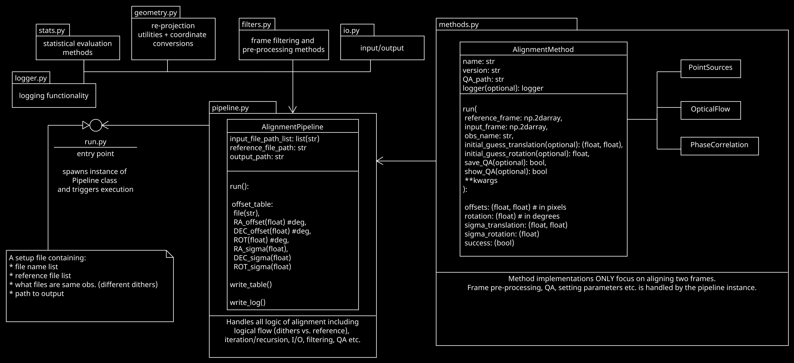

.. _structure:

Overview of all pipeline procedures and their products
======================================================

This page gives an overview of the procedures of the pipeline and the products
of each. Click on any of the procedure names for more information on that step.

Main procedures
---------------

Both main procedures take the :ref:`configuration file <conf>`, the reference
image, the input directory and the output directory.

.. list-table:: Main procedures
    :header-rows: 1

    * - Procedure
      - Products
    * - :ref:`Single method run <run>` (``src/run.py``)
      - ``{method}_alignment_output_table.fits``, dither tables, QA plots, log (see :ref:`output <output>`)
    * - :ref:`Hybrid run <hybrid>` (``src/hybrid_pipeline.py``)
      - ``Hybrid_alignment_output_table.fits``, ``final_difference_images/``, the output of the three method runs

Details of the alignment
------------------------

These pages describe what happens inside the main procedures, and the flags that
control it.

.. toctree::
   :maxdepth: 1

   run
   hybrid
   methods
   rotation_convention
   angle_scan
   scale_ref
   dithers
   output

Tools in ``dev``
----------------

.. list-table:: Tools
    :header-rows: 1

    * - Tool
      - Products
    * - :ref:`Configuration file sorter <sorter>` (``dev/sorter.py``)
      - The configuration ``.json`` file
    * - :ref:`Replot final difference images <replot>` (``dev/replot_final_difference_images.py``)
      - ``final_difference_images_flux/``, ``{table}_alignment_output_table_flux.fits``
    * - :ref:`Table for pymusepipe <pymusepipe>` (``dev/convert_hybrid_table.py``)
      - ``{table}_pymusepipe.fits``

.. toctree::
   :hidden:

   configuration_file
   replot
   pymusepipe
