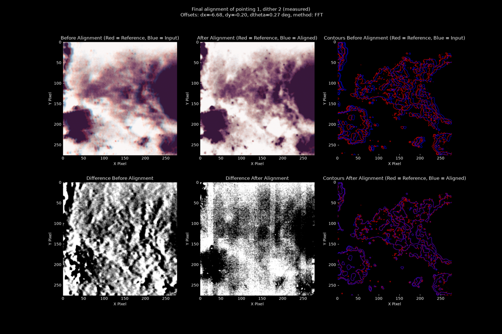
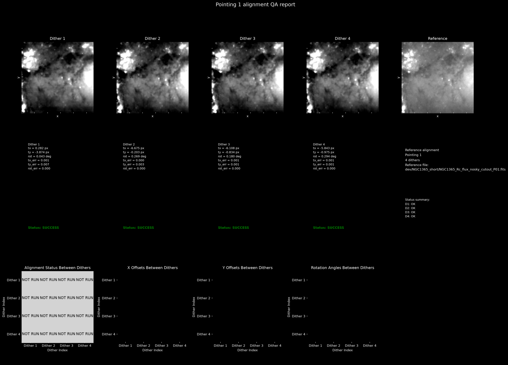
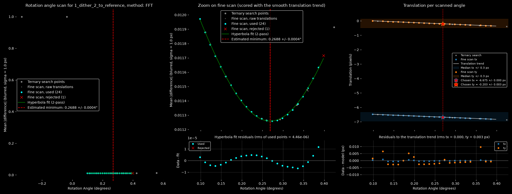
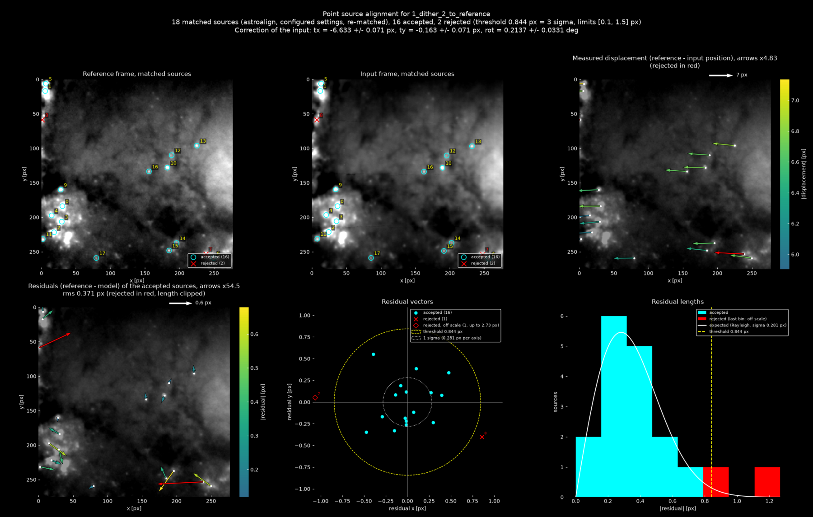

.. _worked_example:

Worked example
==============

This page runs the :ref:`hybrid run <hybrid>` on a small dataset that is shipped
with the repository, and goes through its output.

The data
--------

``dev/NGC1365_short/`` holds:

* the 4 dithers of pointing 1 of NGC1365 (MUSE, ESO programme 1100.B-0651,
  PHANGS-MUSE), reconstructed images in the WFI BB filter
  (``IMAGE_FOV_prealign_P01_WFI_BB_2018-01-10T02-49-23_000{1,2,3,4}.fits``,
  ~310 x 310 pixels of 0.2 arcsec each, image in extension 1);
* a cutout of the WFI R-band reference image of NGC1365
  (``NGC1365_Rc_flux_nosky_cutout_P01.fits``, 521 x 518 pixels of 0.2375 arcsec,
  ~2 x 2 arcmin). It covers the 4 dithers with a margin of 30 arcsec on every
  side. The full reference (5657 x 5340 pixels, 241 MB) gives the same results:
  the offsets agree within 0.001 arcsec (below their errors) and the rotations
  within 0.0012 degrees (the cutout is stored as float32, the full image as
  float64).

The :ref:`configuration file <conf>` is ``dev/NGC1365_short.json``. It lists the
4 exposures of pointing 1 and the FITS keywords to read. In total, the data are
~3 MB.

Running
-------

From the root of the repository (the output directory is created):

.. code-block:: bash

    python src/hybrid_pipeline.py dev/NGC1365_short.json \
        dev/NGC1365_short/NGC1365_Rc_flux_nosky_cutout_P01.fits \
        --input_dir dev/NGC1365_short --output_dir NGC1365_short_HYBRID --plot_headless

On a laptop (AMD Ryzen 5 3500U) the run takes ~16 minutes: 1 min 42 s for the
secondary method (``OpticalFlow``), 56 s for the tertiary (``PointSources``) and
13 min for the primary (``FFT`` with the :ref:`angle scan <angle_scan>`, 1-2 min
per alignment). Peak memory is ~420 MB.

Output directory
----------------

Trimmed (the date in the log names is the start time of the run):

.. code-block:: text

    NGC1365_short_HYBRID/
        Hybrid_alignment_output_table.fits
        aligment_log_2026-11-25_16-00-09.log
        final_difference_images/
            difference_image_1_dither_{1,2,3,4}_final_FFT.png
        secondary_OpticalFlow/
            OpticalFlow_alignment_output_table.fits
            aligment_log_2026-11-25_15-44-33.log
            {x,y,rotation}[_error]_dither_table_1_OpticalFlow.csv
            success_dither_table_1_OpticalFlow.csv
            run_manifest.json
            aligment_QA/
                combined/1_combined_QA_OpticalFlow.png
                dithers/    difference_image_*, flow_field_*  (all dither pairs)
                science/    difference_image_*, flow_field_*
        tertiary_PointSources/
            ...                                   (as above, point_sources_* plots)
        primary_FFT/
            FFT_alignment_output_table.fits
            aligment_log_2026-11-25_15-47-11.log
            ...
            aligment_QA/
                combined/1_combined_QA_FFT.png
                science/    angle_scan_model_*, difference_image_*, eps_vs_sigma_*,
                            translation_peak_*, translation_progression_*

The primary method runs in the ``targeted`` dither mode, and since all its science
alignments worked, it has no ``aligment_QA/dithers`` plots. See
:ref:`output <output>` for all files.

The logs
--------

Every method directory has its own log, and the top-level log only covers the
final table. All logs start with the code version, e.g.:

.. code-block:: text

    INFO - logger.py:151 - Code version: c17246e 2026-11-23 10:29:21 -0300 scaling unit bugfix (branch main), ...
    WARNING - logger.py:153 - Code has uncommitted local changes: ...

The secondary and tertiary runs end with their summaries:

.. code-block:: text

    INFO - pipeline.py:2299 - Summary (OpticalFlow): 4 of 4 exposures aligned, 0 without a result. Peak memory 420 MB.
    INFO - pipeline.py:2299 - Summary (PointSources): 4 of 4 exposures aligned, 0 without a result. Peak memory 421 MB.

The primary log shows the initial guess from ``OpticalFlow``, the direct FFT fit
that is checked against it, and the angle scan (dither 2, timestamps and paths
removed):

.. code-block:: text

    INFO - pipeline.py:759 - Initial guess for science_forward alignment (pointing 1, dither 2) from OpticalFlow: tx = -6.762, ty = -0.218, rot = 0.2731
    INFO - methods.py:6076 - Direct FFT fit for 1_dither_2_to_reference succeeded (rotation 0.3321 degrees), running the angle scan ...
    INFO - methods.py:5858 - Direct fit for 1_dither_2_to_reference agrees with the initial guess, scan sigmas narrowed to [0.600, 0.721] (8 of 126)
    INFO - methods.py:2222 - Ternary search minimum: 0.2483 degrees (13 evaluations)
    ...
    INFO - methods.py:436 - FFT alignment of 1_dither_2_to_reference succeeded in 1 min 08.1 s
    ...
    INFO - pipeline.py:1327 - Pointing 1: all science alignments are clean, no dither alignments needed.

Lines such as ``WARNING - Failed to estimate translation for -0.333 degrees`` come
from the angle scan: at angles far from the minimum the FFT translation does not
pass its checks, and these angles are not used. They are expected.

The top-level log gives the method used for every exposure:

.. code-block:: text

    INFO - hybrid_pipeline.py:159 - Row 0 (DATE_OBS 2018-01-10T02:50:04.000): using FFT.
    INFO - hybrid_pipeline.py:159 - Row 1 (DATE_OBS 2018-01-10T03:07:15.000): using FFT.
    INFO - hybrid_pipeline.py:159 - Row 2 (DATE_OBS 2018-01-10T03:19:57.000): using FFT.
    INFO - hybrid_pipeline.py:159 - Row 3 (DATE_OBS 2018-01-10T03:37:57.000): using FFT.
    INFO - hybrid_pipeline.py:609 - Hybrid summary: 4 exposures, results from FFT: 4
    INFO - hybrid_pipeline.py:619 - Hybrid pipeline finished, total execution time (all three runs): 15 min 39.3 s

All three methods aligned all 4 exposures, so the final table uses ``FFT``
everywhere and there are no fallbacks.

The output table
----------------

``Hybrid_alignment_output_table.fits`` (rounded; ``DATE_OBS``, ``MJD_OBS``,
``TPL_START`` and ``POINTING_OBS`` = 1 left out):

.. list-table::
    :header-rows: 1

    * - IEXPO_OBS
      - RA_OFFSET [deg]
      - RA_OFFSET_ERROR
      - DEC_OFFSET [deg]
      - DEC_OFFSET_ERROR
      - ROTANGLE [deg]
      - ROTATION_ERROR
      - ALIGNMENT_METHOD
    * - 1
      - -1.940e-05
      - 7.8e-08
      - -2.152e-04
      - 3.9e-07
      - 0.0433
      - 0.0001
      - FFT
    * - 2
      - 4.592e-04
      - 2.3e-08
      - -1.125e-05
      - 1.8e-07
      - 0.2688
      - 0.0004
      - FFT
    * - 3
      - 4.202e-04
      - 7.8e-08
      - -4.635e-05
      - 7.6e-08
      - 0.1805
      - 0.0001
      - FFT
    * - 4
      - 4.019e-04
      - 8.3e-08
      - -5.415e-05
      - 6.5e-08
      - 0.2945
      - 0.0002
      - FFT

The offsets are in degrees of RA and Dec (e.g. dither 2: +1.65 arcsec in RA,
-0.04 arcsec in Dec), the rotation in degrees, following the
:ref:`rotation convention <rotation_convention>`. Read the table with e.g.
``astropy.table.Table.read``. See :ref:`output <output>` for the columns.

The three methods agree on the translation within ~0.2 MUSE pixels (from the
logs, in pixels of the frame of dither 1):

.. list-table::
    :header-rows: 1

    * - Dither
      - FFT (tx, ty, rot)
      - OpticalFlow
      - PointSources
    * - 1
      - 0.28, -3.87, 0.043
      - 0.18, -3.71, 0.121
      - 0.08, -3.83, 0.184
    * - 2
      - -6.68, -0.20, 0.269
      - -6.76, -0.22, 0.273
      - -6.63, -0.16, 0.214
    * - 3
      - -6.11, -0.83, 0.180
      - -6.33, -0.67, 0.228
      - -6.19, -0.77, 0.253
    * - 4
      - -5.84, -0.97, 0.294
      - -5.95, -1.01, 0.296
      - -5.78, -0.85, 0.195

The rotations differ by up to ~0.14 degrees between the methods, much more than
the reported FFT errors (~0.0001-0.0004 degrees). The angle error of the scan only
covers the scatter of the scan points around the fit, see
:ref:`known limitations <known_limitations>`.

QA plots
--------

    ``final_difference_images/difference_image_1_dither_2_final_FFT.png``. The
    title gives the final offsets (dx = -6.68 px, dy = -0.20 px, 0.27 degrees,
    measured with FFT). **Top:** reference (red) and dither 2 (blue) before and
    after the alignment, and their contours. Before the alignment the contours are
    offset by several pixels in x; after it they lie on top of each other.
    **Bottom:** the difference images. Before the alignment the difference shows
    the edges of every structure; after it, what remains is mostly the
    large-scale flux difference of the two images (both are only normalised to
    their maximum, see :ref:`reference flux scaling <scale_ref>`), the slicer
    pattern of MUSE (vertical and horizontal stripes) and noise.

    ``primary_FFT/aligment_QA/combined/1_combined_QA_FFT.png``, the one-page
    report of the pointing. **Top:** the 4 dithers and the reference, all on the
    grid of dither 1. **Middle:** the result and the status of every dither (all
    SUCCESS). **Bottom:** the dither - dither tables; they are all "NOT RUN",
    since the primary runs in the ``targeted`` dither mode and no science
    alignment had to be recovered (see :ref:`dither alignment <dithers>`).

    ``primary_FFT/aligment_QA/science/angle_scan_model_1_dither_2_to_reference_FFT.png``.
    **Left:** the whole scan: the ternary search points (grey; the two at 1.0 are
    angles where no translation was found, the warnings in the log) and the fine
    scan between 0.1 and 0.4 degrees. **Middle:** the fine scan (24 points used,
    1 rejected) with the hyperbola fit, minimum at 0.2688 +/- 0.0004 degrees, and
    its residuals, which still show a small wave-like pattern. **Right:** the
    translation per angle with its linear trend; the stars mark the final
    translation (tx = -6.675, ty = -0.203 px).

    ``tertiary_PointSources/aligment_QA/science/point_sources_1_dither_2_to_reference_PointSources.png``.
    18 sources are matched between the reference and dither 2 (mostly in the
    star forming regions on the left and in the centre of the frame), 16 are
    accepted and 2 rejected. The measured displacements (top right) all point in
    the same direction, ~6.6 px. The residuals of the fit (bottom) scatter by
    0.37 px rms, close to the expected Rayleigh distribution. Result:
    tx = -6.633 +/- 0.071 px, ty = -0.163 +/- 0.071 px, rot = 0.214 +/- 0.033
    degrees.

The other QA plots are described on the :ref:`methods <methods>`,
:ref:`angle scan <angle_scan>` and :ref:`dither alignment <dithers>` pages.

Data license
------------

The data in ``dev/NGC1365_short`` are ESO data, made available under the Creative
Commons Attribution 4.0 International license
(`CC BY 4.0 <https://creativecommons.org/licenses/by/4.0/>`_), following the
`ESO data access policy <https://archive.eso.org/cms/eso-data-access-policy.html>`_.
Based on observations collected at the European Southern Observatory under ESO
programme 1100.B-0651. The MUSE frames are from the PHANGS-MUSE survey. See
``dev/NGC1365_short/README.md`` for the origin of the files and how the cutout of
the reference was made.
